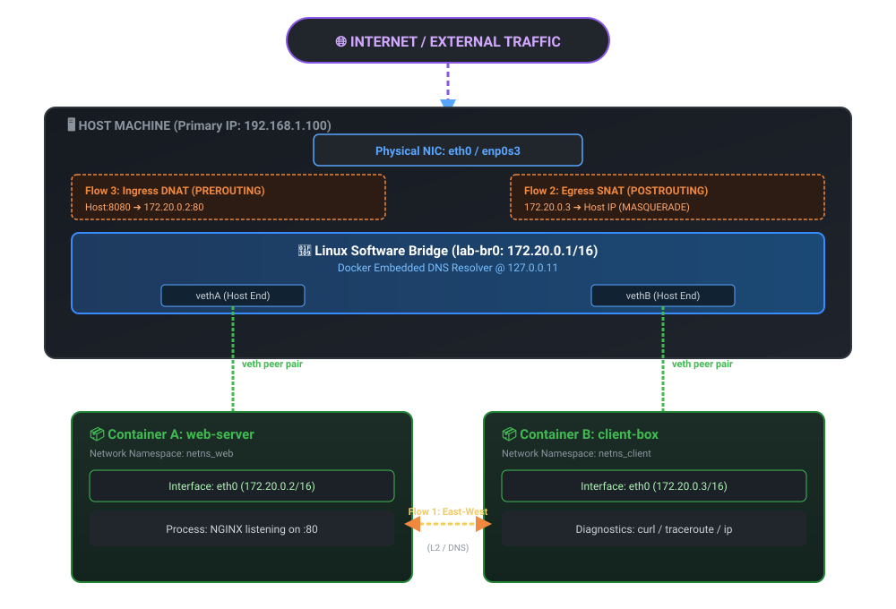

---
quiz:
  enabled: true
---

# 4. Docker Networking (Deep Dive)

Docker networking is built on the **Container Network Model (CNM)** plus the
Linux kernel primitives from [lesson 1](01-fundamentals-architecture.md):
network namespaces (`netns`), virtual ethernet pairs (`veth`), software
bridges, and `iptables`/`nftables` packet filtering.



## Under the hood

```text
+--------------------------------------------------------------------+
| Docker Host                                                        |
|                                                                    |
|  Container A (172.18.0.2)                Container B (172.18.0.3)  |
|     [eth0]                                     [eth0]              |
|        |                                          |                |
|     (vethA)                                    (vethB)             |
|        \____________________   ___________________/                |
|                             \ /                                    |
|                        [docker0 / br0]  (172.18.0.1)               |
|                              |                                     |
|                        NAT / iptables                              |
|                              |                                     |
|                        Host [eth0] (e.g., 192.168.1.100)           |
+--------------------------------------------------------------------+
```

- **Network namespace** — isolated network stack per container (own routes,
  ARP table, firewall, interfaces)
- **`veth` pair** — a virtual patch cable: one end on the host, one end as the
  container's `eth0`
- **`docker0`** — Layer 2 software bridge the host `veth` ends plug into

## Network drivers

| Driver | Scope | Behavior / use case |
|---|---|---|
| `bridge` (default) | single host | isolated virtual bridge per host; standard for standalone & composed containers |
| `host` | single host | no isolation — container shares the host IP/ports/interfaces |
| `none` | container | total isolation — only loopback `lo` |
| `container:<id>` | container | joins an existing container's netns — **the Kubernetes Pod model** |
| `overlay` | multi-host | VXLAN tunnels across Docker daemons (Swarm) |
| `macvlan`/`ipvlan` | physical LAN | container gets a real MAC/IP on the host network |

## Default bridge vs user-defined bridge

=== "Default `docker0`"

    Automatic when `docker run` has no `--network`. **No embedded DNS** —
    containers reach each other only by IP (or deprecated `--link`).

=== "User-defined bridge"

    ```bash
    docker network create --driver bridge my-app-net
    docker run -d --name db  --network my-app-net postgres:16
    docker run -d --name web --network my-app-net -p 8080:8080 my-web-app
    ```

    - **Embedded DNS at `127.0.0.11`** — `web` reaches `db:5432` by the
      hostname `db`
    - **Isolation** — containers on different bridges can't talk without an
      explicit second attachment
    - Clean attach/detach of running containers: `docker network connect`

!!! tip "Rule of thumb"
    Always make a user-defined network for anything beyond a toy. DNS service
    discovery alone is worth it.

## Traffic flows

**Container → container (east-west):** L2 switching across the bridge — no NAT.

**Container → external (egress):** packets route to the gateway (bridge IP),
host `iptables` applies **SNAT/MASQUERADE**, rewriting `172.20.0.x` to the host
IP.

**External → container (ingress):** `-p host:container` programs **DNAT** rules
— `Host:8080` → `ContainerIP:80`.

## EXPOSE vs publish

- `EXPOSE 80` in a Dockerfile = **metadata**; reachable only inside Docker
  networks, invisible to the host
- `-p <host_port>:<container_port>` = actual `iptables` DNAT forwarding on the host

## Multi-host overlay (Swarm/K8s context)

Overlay drivers encapsulate L2 container frames inside UDP (**VXLAN**, port
4789) so containers on Host A and Host B share one flat subnet. In Kubernetes
the same job is done by CNI plugins (Calico, Cilium, Flannel).

## Mapping to Kubernetes (preview)

| Docker | Kubernetes |
|---|---|
| `--net=container:<id>` | Pod — containers share the `pause` container's netns |
| `-p 8080:80` (host DNAT) | `Service` (`ClusterIP`/`NodePort`/`LoadBalancer`) via `kube-proxy` |
| embedded DNS `127.0.0.11` | CoreDNS — `<svc>.<ns>.svc.cluster.local` |
| `overlay` driver | CNI plugin (Calico/Cilium/Flannel) — flat IP-per-Pod |

---

## Lab

**`bridge-dns-lab`** — [lab page](labs/bridge-dns-lab.md)
· `src/04-networking/bridge-dns-lab/` (skeleton lab, 10 TODOs)

Prove: default bridge has no DNS · user-defined `lab-net` resolves names via
`127.0.0.11` · `EXPOSE` alone doesn't reach the host · `--network none` leaves
only `lo`.

```bash
cd src/04-networking/bridge-dns-lab   # fill in commands.sh TODOs
```

### Extra credit — packet tracing

Spin the lab network up with `nicolaka/netshoot` and trace all three flows:

```bash
docker network create --subnet 172.20.0.0/16 docker-lab-net
docker run -d --name web-server --net docker-lab-net -p 8080:80 nginx:alpine
docker run -d --name client-box --net docker-lab-net nicolaka/netshoot sleep 3600

docker exec -it client-box ping -c 2 web-server     # east-west + DNS
docker exec -it client-box curl -I https://google.com   # egress via SNAT
docker exec -it client-box traceroute -n -m 3 8.8.8.8
curl -I http://localhost:8080                        # ingress via DNAT

docker rm -f web-server client-box && docker network rm docker-lab-net
```

---

## Check yourself

<quiz>
On the default docker0 bridge, container A can reach container B by...
- [ ] Container name — Docker DNS handles it
- [x] Raw IP address only — the default bridge has no embedded DNS
- [ ] Hostname — it's in /etc/hosts automatically
- [ ] Service name registered in etcd
</quiz>

<quiz>
`cat /etc/resolv.conf` inside a container on a user-defined bridge shows [[127.0.0.11]] — Docker's embedded DNS
</quiz>

<quiz>
A Dockerfile has `EXPOSE 80` but `docker run` has no `-p`. From the HOST, the app is:
- [ ] Reachable on localhost:80 automatically
- [x] Unreachable — EXPOSE is metadata; only -p configures host DNAT
- [ ] Reachable after docker restart
- [ ] Reachable via container name from the host shell
</quiz>

<quiz>
Outbound traffic from a container reaches the internet because the host applies...
- [ ] DNAT in the PREROUTING chain
- [x] SNAT/MASQUERADE rewriting the container IP to the host IP
- [ ] VXLAN encapsulation
- [ ] A static route in CoreDNS
</quiz>

<quiz>
Which Docker network mode is the direct equivalent of how containers share a Kubernetes Pod?
- [ ] bridge
- [ ] overlay
- [x] container:&lt;id&gt;
- [ ] macvlan
</quiz>

**Next:** [5. Docker Compose](05-docker-compose.md)
