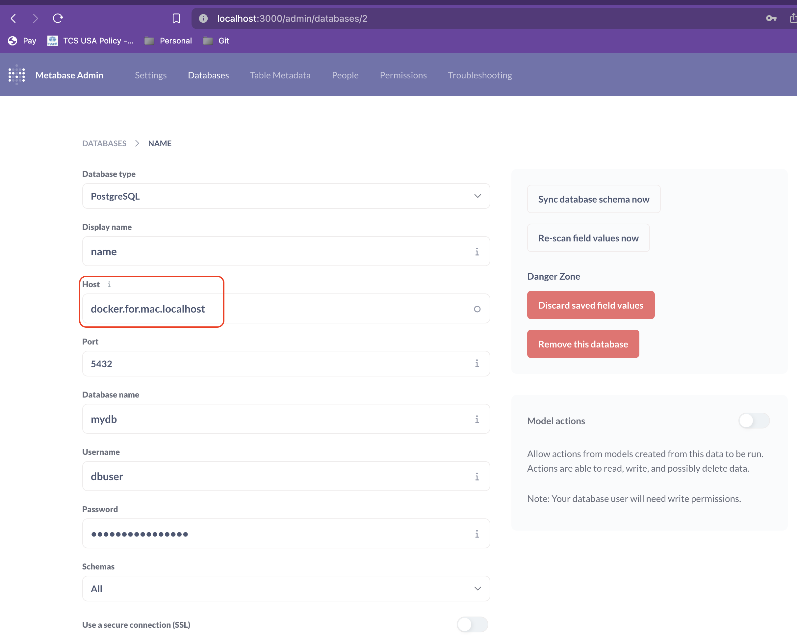

# Lab: Compose — Postgres with Init Scripts

**Lesson:** [05 — Docker Compose](https://github.com/nitinkc/DockerConcepts/blob/main/docs/05-docker-compose.md)

Postgres containerized with `env_file`, a `healthcheck`, and every file in
`db/` executed in name order via `/docker-entrypoint-initdb.d/` on **first boot**:

- `01-init.sh` — creates app role, database, schema, `event` table
- `02-schema.sql` — `test` schema + `student` table
- `03-data.sql` — seed rows

## Run

```shell
cd src/05-compose/compose-db

docker compose up --build        # first boot runs db/ scripts
docker compose down              # stop and remove containers

# clean rebuild when scripts change:
docker compose build --no-cache
```

## Inspect the running container

```shell
docker compose ps
docker exec -it <postgres_container_id> /bin/bash
cd docker-entrypoint-initdb.d && ls -lrt

# or query directly
docker exec -it <postgres_container_id> psql -U dbuser -d mydb -c '\dt test.*'
```

## Init scripts only run once

`/docker-entrypoint-initdb.d/` runs only when the data directory is **empty**.
The compose file bind-mounts `./db` for scripts but postgres writes data to its
default location — if you later add a named volume and scripts seem "skipped",
`docker compose down -v` to wipe it.

## Metabase (commented-out service)

Uncomment `metabase` + `postgres-init` in `docker-compose.yml` and toggle with
`ENABLE_*` vars in `.env`. Connection host inside the network is the service
name `postgres` (embedded DNS!), not `localhost`.



## Practice from memory

1. Rewrite the `postgres` service block from scratch: `image`, `env_file`,
   `healthcheck`, `volumes`, `ports`, `networks`.
2. Add a **named volume** `pgdata` for `/var/lib/postgresql/data`, `down -v`,
   `up`, and prove seed data persists only through the volume's lifetime.
3. `docker compose exec postgres psql ...` vs `docker exec` — what's different
   about how the target is named?
